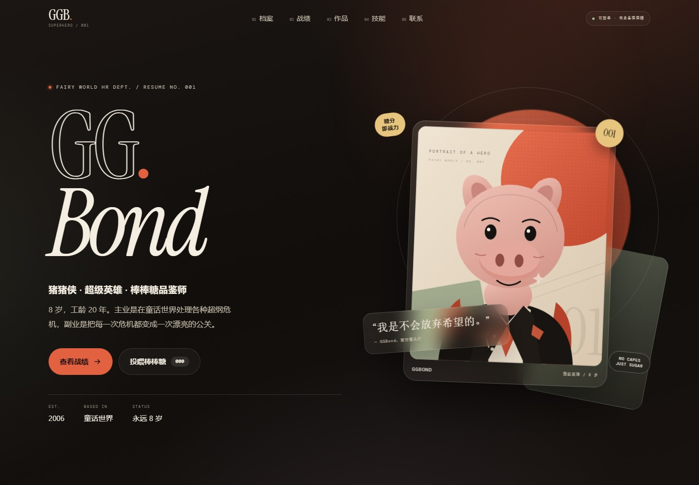

# GGBond — 个人网站

> 8 岁，工龄 20 年。主业拯救世界，副业准点下班。

一个用 **纯 HTML / CSS / JavaScript** 做的个人简历网站，主角是《猪猪侠》里的 GGBond（猪猪侠）。整活向，但视觉和工程都是认真的：艺术馆质感的暗色编辑风、毛玻璃图层、颗粒噪点、手绘 SVG 肖像、滚动显现、可投喂的棒棒糖计数器，以及一份打印出来还算体面的简历。

站点没有任何构建步骤、后端、数据库、Cookie 或第三方统计。推送到 GitHub 后由 **Cloudflare Pages** 自动部署，完全跑在免费额度内。



---

## 为什么是 GitHub + Cloudflare Pages

| 需求 | 方案 |
| --- | --- |
| 代码托管 / 版本管理 | GitHub 公共仓库 |
| 静态托管 / 全球 CDN | Cloudflare Pages（免费计划） |
| 自动部署 | Cloudflare 连接 GitHub 仓库，推送到 `main` 即部署 |
| HTTPS / 自定义域名 | Cloudflare 自动签发证书，支持绑定自己的域名 |
| 构建成本 | 0。没有构建命令，纯静态文件直接发布 |

> 备选方案：GitHub Pages + Cloudflare DNS 也可以，但 Pages 的 Git 集成、预览部署和 CDN 体验更省心，且同样免费。

---

## 本地预览

不需要安装任何依赖。任选一种：

```powershell
# Python 3
python -m http.server 8000

# 或者 Node
npx serve .
```

然后打开 <http://localhost:8000>。

直接双击 `index.html` 也能看到大部分内容，但为了字体、相对路径和 `localStorage` 行为正常，建议用本地服务器。

---

## 目录结构

```text
ggbond-portfolio/
├─ index.html              # 页面内容与结构（文案都在这里改）
├─ styles.css              # 设计系统、布局、响应式、打印样式
├─ script.js               # 导航、滚动显现、计数器、光标光晕、肖像微倾斜
├─ 404.html                # Cloudflare Pages 自定义 404
├─ favicon.svg             # 站点图标
├─ og.png                  # 社交分享图（1200 × 630）
├─ site.webmanifest        # PWA / 图标信息
├─ robots.txt              # 搜索引擎规则
├─ _headers                # Cloudflare Pages 安全响应头与缓存策略
├─ assets/
│  ├─ preview.jpg          # README 预览图
│  └─ fonts/               # 自托管的 Instrument Serif + DM Mono（OFL）
└─ README.md
```

---

## 部署到 GitHub + Cloudflare Pages

### 1. 推到 GitHub

当前目录已经是一个本地 Git 仓库，并完成了首次提交。你只需要在 GitHub 上创建一个**空仓库**（不要勾选 README、.gitignore、License），然后执行：

> 首次提交使用的是占位身份 `GGBond <ggbond@users.noreply.github.com>`。如果想换成自己的 GitHub 身份，先执行 `git config user.name "你的名字"`、`git config user.email "你的邮箱"`，再执行 `git commit --amend --reset-author --no-edit`。

```powershell
git remote add origin https://github.com/<你的用户名>/ggbond-portfolio.git
git branch -M main
git push -u origin main
```

如果本机安装了 [GitHub CLI](https://cli.github.com/)，可以一条命令搞定建仓和推送：

```powershell
winget install --id GitHub.cli -e
gh auth login
gh repo create ggbond-portfolio --public --source=. --remote=origin --push
```

### 2. 在 Cloudflare 创建 Pages 项目

1. 登录 [Cloudflare Dashboard](https://dash.cloudflare.com/)。
2. 左侧进入 **Workers & Pages** → **Create application** → **Pages** → **Connect to Git**。
3. 授权 GitHub，选择 `ggbond-portfolio` 仓库。
4. 填写项目配置：
   - **Project name**：`ggbond-portfolio`（或你喜欢的名字）
   - **Production branch**：`main`
   - **Framework preset**：`None`
   - **Build command**：留空
   - **Build output directory**：`/`
5. 点击 **Save and Deploy**。首次部署通常几秒内完成。
6. 部署成功后会得到一个 `https://<项目名>.pages.dev` 地址。

### 3. 自动部署

Cloudflare Pages 连接仓库后：

- 每次推送到 `main` → 自动构建并发布到生产环境。
- 推送到其他分支或发起 Pull Request → 自动生成预览地址，不影响线上。
- 不需要配置任何 GitHub Secrets 或环境变量。

### 4. 绑定自定义域名（可选）

在 Pages 项目里进入 **Custom domains** → **Set up a custom domain**：

- 域名已经托管在 Cloudflare：输入域名，DNS 会自动添加。
- 域名不在 Cloudflare：按提示到域名商添加 `CNAME`，指向 `<项目名>.pages.dev`。

HTTPS 证书由 Cloudflare 自动签发和续期。

> 部署后建议把 `index.html` 里的 `og:image` 改成完整地址，例如 `https://你的域名/og.png`，这样社交平台抓取更稳定。

---

## 想改内容？从这里下手

| 想改什么 | 去哪里 |
| --- | --- |
| 姓名、简介、经历、作品、联系方式 | `index.html`（有清晰的分段注释） |
| 主色、字体、圆角、间距 | `styles.css` 顶部的 `:root` 变量 |
| 投喂棒棒糖的文案 | `script.js` 里的 `ordinaryMessages` 和 `milestoneMessages` |
| 404 页面 | `404.html` |
| 安全响应头 / 缓存 | `_headers` |
| 社交分享图 | 替换 `og.png`，并同步更新 `og:image` |
| 预览图 | 替换 `assets/preview.jpg` |

改完直接 `git add . && git commit -m "update content" && git push`，Cloudflare 会自动发布。

### 换成自己的信息

这个项目默认使用 GGBond 的同人设定。如果你想把它改成真正的个人简历：

1. 把 Hero 的 `GGBond`、`猪猪侠`、简介和 meta 信息换成你的。
2. 把「个人档案」「职业战绩」「精选作品」「核心技能」四段换成你的经历。
3. 把联系区的互动按钮保留、文案改成你的合作方式。
4. 把 `assets/` 里的 SVG 肖像换成你的头像或插画（建议同样用 SVG/WebP，控制体积）。
5. 更新 `index.html` 里的 `<title>`、`description`、Open Graph 和 JSON-LD。

---

## 设计与实现说明

- **字体**：Instrument Serif（标题）与 DM Mono（标签）自托管，避免依赖 Google Fonts；中文回退到系统宋体/黑体。
- **视觉**：暗色暖调底、珊瑚橙 + 奶油白 + 鼠尾草绿，低饱和、重排版；没有霓虹渐变和赛博网格。
- **图层**：毛玻璃卡片、半透明色块、颗粒噪点、光标径向光晕、SVG 印刷网点。
- **动效**：滚动显现、肖像轻微 3D 倾斜、跑马灯、缓慢漂浮的棒棒糖；全部尊重 `prefers-reduced-motion`。
- **交互**：投喂计数器写入 `localStorage`，刷新后保留；点击时飘出棒棒糖并显示随机文案。
- **无障碍**：语义化结构、跳过导航链接、键盘焦点样式、`aria` 标签、状态提示 `aria-live`。
- **打印**：点击「打印这份简历」会隐藏装饰和交互，输出一份白底、紧凑的简历版式。
- **性能**：无框架、无外部请求、字体合计约 70 KB，页面只有 HTML/CSS/JS 与内联 SVG。

---

## 免责声明

这是一个**非官方、非商业的同人整活项目**。“猪猪侠 / GG Bond”角色及相关作品版权归广东咏声动漫股份有限公司等权利人所有。本站不使用官方图片、视频或音频；页面中的小猪肖像为原创 SVG 插画，仅用于个人学习与娱乐。如有侵权，请联系删除。

## License

- 代码（HTML/CSS/JS）与原创插画：MIT，见 [LICENSE](LICENSE)。
- 字体：SIL Open Font License 1.1，见 `assets/fonts/OFL-*.txt`。
